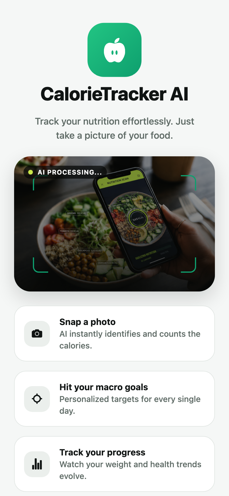
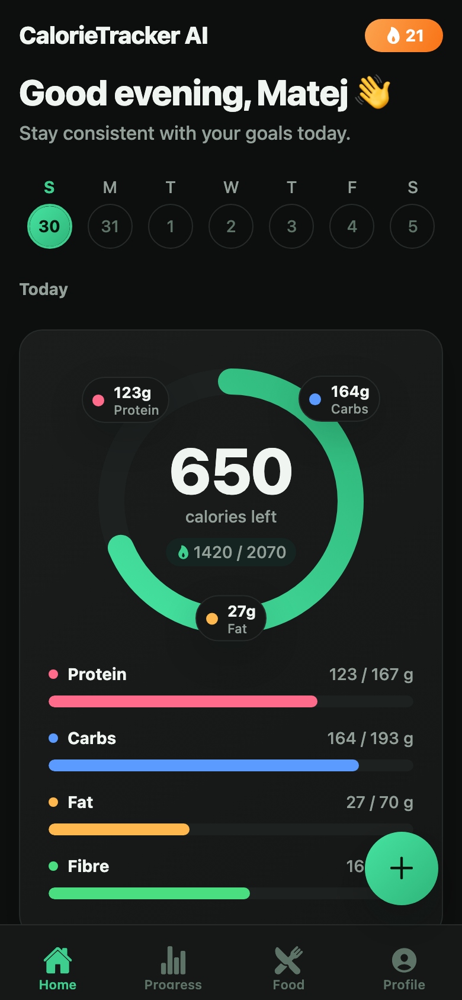
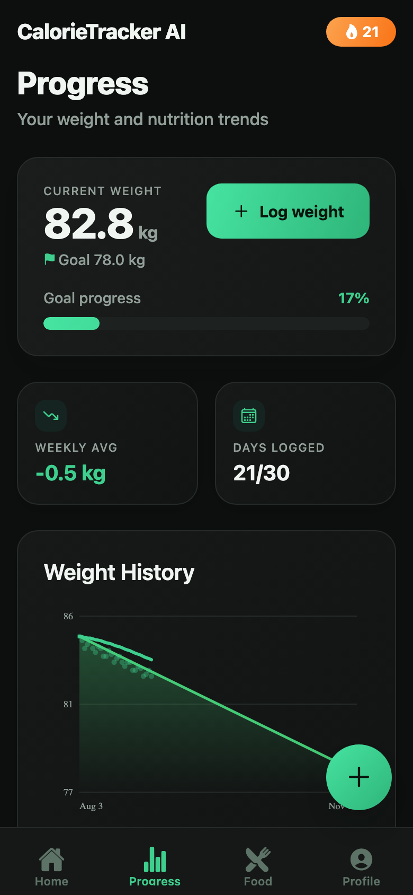
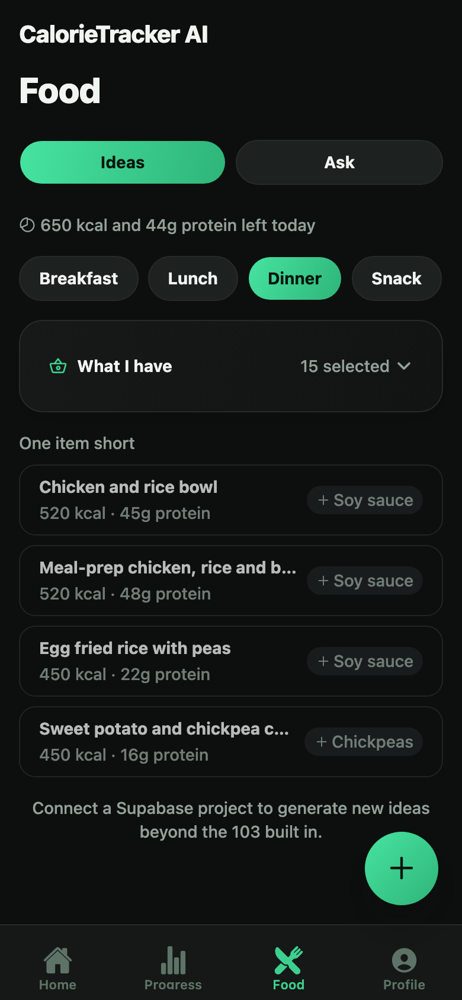
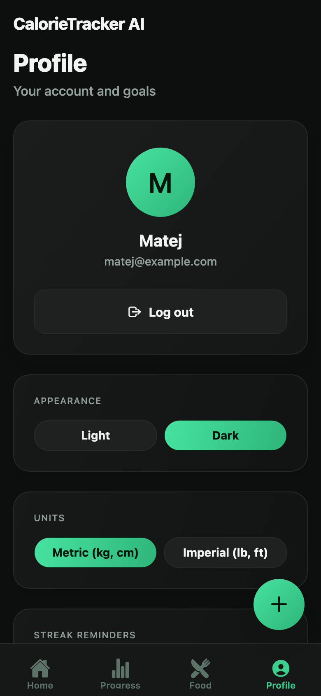
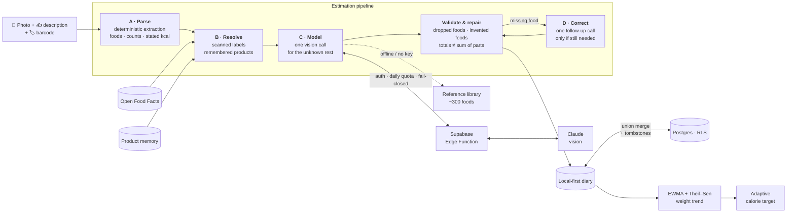

<div align="center">

# AI Calorie Tracker

**Snap a meal, get calories and macros. An adaptive nutrition coach built around a vision-model pipeline that never lets the model own the numbers.**








<sub><b>Welcome</b> · <b>Home</b> dashboard · <b>Progress</b> weight trend &amp; adaptive plan · <b>Food</b> ideas ranked against what's left today · <b>Profile</b></sub>

</div>

## Why I built it

I wanted the experience of apps like Cal AI without a yearly subscription, so I built my own: photo and text meal logging with a vision model, exact barcode nutrition, and a calorie and macro plan that adapts to real progress. It runs on iOS, Android and web from one Expo codebase, and costs less than €1 a month to run for personal use on free tiers and pay-per-call AI.

### Highlights

| | |
|---|---|
| 📸 **Vision-model meal estimates** | Photo and/or description → calories and macros, validated before they reach the diary |
| 🏷️ **Barcode scanning** | Exact label nutrition from Open Food Facts; label values are never re-estimated |
| 📈 **Adaptive plan** | Mifflin-St Jeor targets that follow a smoothed (Theil–Sen) weight trend toward your goal |
| 🍽️ **Food ideas & Ask** | Recipes ranked against your pantry and remaining budget; questions answered from your own log |
| 🔒 **Secure AI access** | API key behind a Supabase Edge Function with per-user daily limits, failing closed |
| 📴 **Offline first** | Fully usable without a backend; sync is a tested union merge |

## 🧠 How it works

Most AI calorie apps send a photo to a model and print whatever comes back. This one treats the model as **one untrusted source of evidence among several**, inside a staged estimation pipeline with a strict evidence hierarchy:

> **A number you typed beats a barcode. A barcode beats the model. The model is only asked about the part nobody else can answer.**



### The estimation pipeline

| Stage | What happens | Why it matters |
|---|---|---|
| **A · Parse** | A deterministic parser extracts every food, count and number you wrote, before any model sees it. | "3 cans", "the milk is 150 kcal" and "…of tuna" become hard constraints that can be checked afterwards. |
| **B · Resolve** | Scanned labels and remembered products are filled in from real data. "1 scoop protein powder" resolves to *your* powder, scaled by arithmetic, not by a guess. | Known items cost zero model calls and cannot be hallucinated. Unknown conversions surface as a visible question, never a silent 100 g. |
| **C · Model** | One Claude vision call estimates only what is left on the plate. | Smaller question, cheaper call, fewer ways to be wrong. |
| **Validate & repair** | Deterministic checks catch the failures that look exactly like a correct answer: an invented ingredient, a dropped one, a wrong count, a total that disagrees with its own components. Most are repaired in place. | The meal total is always recomputed as the sum of its parts. |
| **D · Correct** | A single corrective call, only when a food you named is genuinely missing. | Keeps the average meal at one model call. |

The model transport is injected rather than imported, so the entire pipeline, prompts and repair rules included, is tested without a network, a key or a backend.

### Built like a production system

- **Secure AI gateway.** The Anthropic key never ships in the app. Every call goes through a Supabase Edge Function that verifies the session and enforces a per-user daily quota, and a broken limiter fails *closed*, never open.
- **Local-first sync that cannot lose data.** The device is always the working copy; the cloud is a mirror. Sync decisions are pure functions with one guarantee: no record is ever lost unless an explicit tombstone says so. Conflicts resolve to the newest write, everything else is a union.
- **Signal from noisy scale readings.** Daily weight swings are larger than the fat-loss signal under them. A causal exponentially weighted average draws the trend, and a robust Theil–Sen fit measures the rate the adaptive calorie engine runs on, so one salty dinner cannot move your target.
- **Long-cut safeguards.** After months of dieting the app watches for deficits that quietly grew too large or stalled adherence, and advises rather than overriding the plan, with deliberately slow triggers so water retention cannot set them off.
- **Ask your own log.** Questions like "how much protein did I average this week?" are answered from your diary through a retrieval step over your own entries; strictly read-only.
- **Graceful degradation.** With no backend the whole app still works: estimates fall back to a deterministic reference-library lookup, and nothing leaves the device.

## Get started

```bash
npm install
npx expo start     # then press i (iOS), a (Android), or w (web)
```

Other scripts:

```bash
npm run ios        # open iOS simulator
npm run android    # open Android emulator
npm run web        # open in the browser
npm run lint       # expo lint
npx tsc --noEmit   # type-check
```

The app runs out of the box with **no configuration** — food estimation falls
back to an offline heuristic and data is stored locally. Add an Anthropic key
and a Supabase project (below) to unlock real AI estimates and cloud sync.

## What's in the box

- **Expo Router** file-based routing with a bottom tab bar (Home · Progress · Food · Profile) plus modal screens for logging.
- **Onboarding wizard** that collects your stats and computes a personalized calorie/macro plan (Mifflin-St Jeor BMR × activity, adjusted toward a target weight/date).
- **AI food logging** — snap a photo and/or describe a meal and get a calorie + macro estimate from Claude's vision model, with an offline keyword heuristic as a no-key fallback.
- **Barcode scanning** — scan a packaged product's barcode for exact, label-sourced nutrition (via the free [Open Food Facts](https://world.openfoodfacts.org) database). More accurate than a photo guess for anything with a label.
- **Food ideas & Ask** — a Food tab that ranks 100+ bundled recipes against what you
  actually have in the pantry and the calories/protein you have *left today*, learning
  from what you have logged before; plus a read-only Ask surface that answers questions
  about your own food log. Both work without a backend, and get better with one.
- **Weight tracking** with an SVG trend chart and projection toward your goal.
- **Accounts & cloud sync** — optional Supabase email/password auth; meals and weights sync per-user across devices, while meal photos stay on the device (local-only until configured).
- **Premium, motion-rich design** — a dark-first theme built around a focused emerald accent on flat near-black surfaces, animated calorie rings, smoothly-filling macro bars, shimmer loading states, confetti on streak milestones, and haptic feedback. All colors/shadows live as tokens in [`src/constants/theme.ts`](src/constants/theme.ts); light & dark are both first-class.
- **Streak reminders** — optional local notifications (no-ops on web).

## Project structure

```
src/
├── app/                      # Routes (Expo Router)
│   ├── _layout.tsx           # Root: providers, splash, auth-gated stack
│   ├── +not-found.tsx        # 404 route
│   ├── add.tsx               # Log food — photo / description / barcode
│   ├── log-weight.tsx        # Log a body-weight measurement
│   ├── entry/[id].tsx        # Edit or delete a logged food
│   ├── (auth)/               # Signed-out group: welcome → onboarding → sign-in
│   └── (tabs)/               # Signed-in bottom tabs
│       ├── index.tsx         # Home — today's dashboard & meal list
│       ├── progress.tsx      # Progress — weight chart, streak, calendar
│       ├── food.tsx          # Food — ranked meal ideas + Ask your log
│       └── profile.tsx       # Profile — goals & preferences
├── components/               # Reusable UI (Card, Button, Field, CalorieRing, WeightChart, BarcodeScanner…)
├── context/                  # App state: Auth, Diary, Theme, Food, Celebration
├── lib/
│   ├── claude.ts             # The one AI transport — calls the Supabase Edge Function
│   ├── ai.ts                 # Fused photo/description/barcode estimation (+ fallback)
│   ├── recipes.ts            # Ranks meal ideas against pantry & remaining budget
│   ├── food-qa.ts            # The Ask surface — retrieval over your own log
│   ├── recipe-data.ts        # Bundled ingredients & recipes
│   ├── food-library.ts       # ~300 foods per 100 g, with named portions
│   ├── barcode.ts            # Barcode → nutrition via Open Food Facts
│   ├── nutrition.ts          # Calorie/macro/BMR math + date & unit helpers
│   ├── weight-trend.ts       # Smoothed bodyweight & Theil–Sen rate fitting
│   ├── sync.ts / merge.ts    # Pure sync decisions & union merge (heavily tested)
│   ├── image.ts              # Camera/library photo picking + compression
│   ├── supabase.ts           # Supabase client (cloud sync)
│   ├── remote.ts             # Cloud persistence
│   ├── notifications.ts      # Local streak reminders
│   └── storage.ts            # Typed AsyncStorage wrapper
├── constants/theme.ts        # Colors, spacing, radii, fonts
├── hooks/                    # useTheme, useColorScheme, useEntryPhoto
└── types/index.ts            # Domain types (FoodEntry, Goals, Profile…)
```

## Configuration

Both are optional — the app works local-only without them. Copy your keys into
`.env` (gitignored) and restart the dev server.

### AI food estimation (Anthropic)

The Anthropic key is **not** an app environment variable. It lives as a Supabase
secret behind an Edge Function, so it is never compiled into the bundle:

```
supabase secrets set ANTHROPIC_API_KEY=sk-ant-...
supabase functions deploy claude
```

[`src/lib/claude.ts`](src/lib/claude.ts) sends the signed-in user's Supabase
access token to that function, which verifies the session, counts the call
against a per-user daily limit, and forwards it to Claude Haiku (the cheapest
vision model). Without a Supabase project configured, `estimateFood` falls back
to an offline keyword heuristic over the bundled food library, so the logger
always works. Barcode scanning needs no key at all.

> ⚠️ **Never reintroduce `EXPO_PUBLIC_ANTHROPIC_API_KEY`.** Every
> `EXPO_PUBLIC_` variable is inlined into the JavaScript bundle and is readable
> by anyone with the app or the web build — and a leaked Anthropic key is a
> bill, not just an exposure. There is deliberately no direct-to-Anthropic
> fallback in the client for the same reason.

### Cloud sync & accounts (Supabase)

```
EXPO_PUBLIC_SUPABASE_URL=https://YOUR-PROJECT.supabase.co
EXPO_PUBLIC_SUPABASE_ANON_KEY=YOUR-ANON-PUBLIC-KEY
```

Run [`supabase/schema.sql`](supabase/schema.sql) in the Supabase SQL editor to
create the tables, row-level security, and the AI usage limiter. It is
idempotent and additive, so it is also the upgrade path for an existing
project. Meal photos are **not** uploaded — they stay on the device, which is
what keeps years of logging inside the free tier. Full
walkthrough in [`supabase/SETUP.md`](supabase/SETUP.md). The anon key is safe to
ship — RLS is what protects each user's data.
